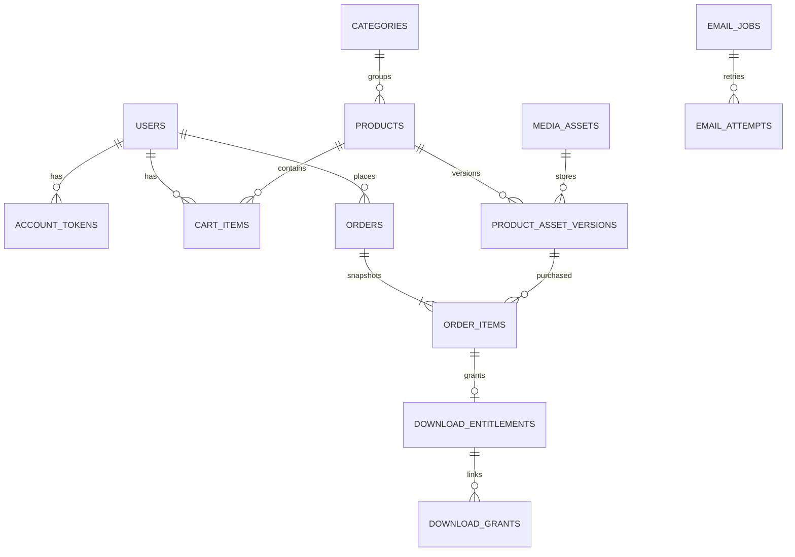

# Database

MySQL 8, InnoDB, Flyway. Migration V1 tạo các bảng; V2 tạo danh mục và sản phẩm DRAFT. Chưa có bảng payment_attempts hoặc payment_events vì chưa triển khai API thanh toán.

- `users.email`: unique; role chỉ do server cấp.
- `orders(user_id,idempotency_key)`: unique để chống lặp yêu cầu.
- `cart_items(user_id,product_id)`: unique; số lượng mỗi sản phẩm bằng 1.
- `order_items(order_id,product_id)`: unique.
- `download_entitlements.order_item_id`: unique.
- `download_grants.token_hash`, `account_tokens.token_hash`: unique SHA-256; không lưu token ở cột này dưới dạng rõ.
- `product_asset_versions(product_id,version_number)`: unique.
- Giá: DECIMAL(18,2); snapshot tổng/giá, giấy phép và phiên bản file theo đơn.
- Thumbnail và preview: products tham chiếu media_assets. File gốc: đi qua product_asset_versions.
- product_tags và product_collections là bảng nối nhiều–nhiều.
- Session: SPRING_SESSION và SPRING_SESSION_ATTRIBUTES; backend quản lý vòng đời.
- Các mốc nghiệp vụ được ghi bằng UTC; UI hiển thị theo múi giờ trình duyệt.
- Danh sách đơn/email/admin hiện phân trang 50 dòng; lịch sử đơn tài khoản trả toàn bộ trong MVP, nên bổ sung phân trang nếu dữ liệu tăng lớn.
- Không xóa vật lý sản phẩm hoặc tài nguyên đã bán. Archive giữ nguyên tham chiếu lịch sử.

Có thể đọc các migration SQL trực tiếp tại backend/src/main/resources/db/migration. Không áp dụng SQL tay vào database đã được Flyway quản lý.
